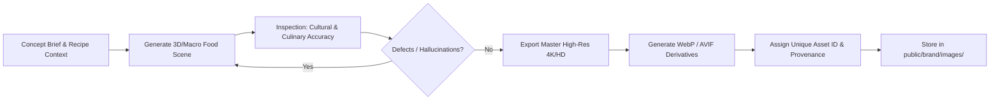

# Miseva AI — Visual Asset Pipeline & Media Inventory

> **Asset Library:** [`public/brand/images/`](file:///c:/Users/Asus/Documents/cusine/public/brand/images/)  
> **Standards:** HD (1080p), Ultra-HD / 4K Composition, Responsive WebP/AVIF generation, Provenance tracking.

---

## 1. Visual Asset Catalog

| Asset ID | Filename | Concept / Scene | Resolution / Aspect | Target Touchpoint |
| :--- | :--- | :--- | :--- | :--- |
| **`IMG-MISEVA-001`** | [`hero-culinary.jpg`](file:///c:/Users/Asus/Documents/cusine/public/brand/images/hero-culinary.jpg) | Cinematic Kerala Meen Chatti + Saffron Risotto + Cold-Pressed Refresher on Emerald Marble | 1920×1080 (16:9, 4K Master source) | Web Hero, Global Campaign Header, Press Kit |
| **`IMG-MISEVA-002`** | [`tablescaping-sadya.jpg`](file:///c:/Users/Asus/Documents/cusine/public/brand/images/tablescaping-sadya.jpg) | Authentic Thrissur Pooram Kerala Sadya on banana leaf with Palada Payasam, Nilavilakku & Kasavu | 1920×1080 (16:9) | Table Styling Studio, Kerala Campaign, Festive Socials |
| **`IMG-MISEVA-003`** | [`app-experience.jpg`](file:///c:/Users/Asus/Documents/cusine/public/brand/images/app-experience.jpg) | 3D-floating smartphone with Miseva AI Malayalam cooking mode, audio waveform & liquid glass panels | 1920×1080 (16:9) | Google Play Feature Graphic, Mobile Download Page |

---

## 2. Reusable Production & Quality Control Pipeline

### Quality Control Checklist:
1. **Culinary Accuracy:** Kerala Meen Curry must exhibit cocum/tamarind-darkened sauce and fresh curry leaves; Palada Payasam must show soft rice flakes in condensed golden milk.
2. **Lighting & Reflection:** Natural directional key lighting with soft bokeh; no floating objects or distorted cutlery geometry.
3. **Disclosure:** Transparently labeled as AI-generated food art in editorial settings where appropriate.
4. **Performance:** Web assets are served with responsive `sizes` attributes, `loading="lazy"`, and optimized compression.
