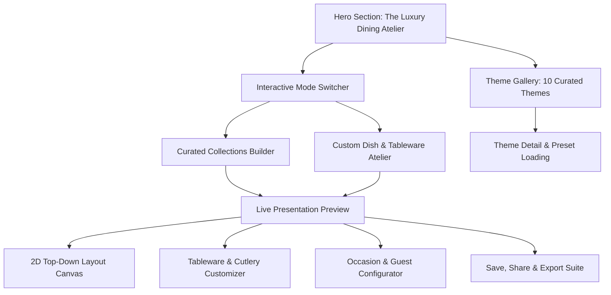

# Miseva AI — Table Styling Studio Luxury Redesign Specification

## 1. Executive Summary & Intent

Miseva AI's **Table Styling Studio** is being transformed from a static concept catalog into an interactive, five-star luxury dining atelier. Inspired by royal banquets, Michelin-starred establishments, and luxury hospitality (Ritz-Carlton, Oberoi, Taj Palaces), the studio combines:
- **10 Distinct Visual Themes**: Each with its own unique tableware, cutlery finish, color palette, lighting, background, and cultural storytelling.
- **Luxury Cutlery & Professional Table Setting**: Strict adherence to course progression, formal place settings, charger plates, crystal stemware, and napkin folding.
- **Curated Meal Collections**: Real culinarily compatible dining experiences (Kerala Grand Lunch, Royal Indian Dinner, Continental Fine Dining, Elegant Afternoon Tea, Dessert Indulgence, Fresh Juice Bar) as well as custom dish pairing.
- **Harmonized Storytelling**: Every theme and presentation features a cohesive Theme Title, evocative Catchphrase, curated Description, and matching imagery.
- **Theme-Specific Image Generation Engine**: Parametric AI prompt engineering synthesizing cuisine, dishes, cutlery, tableware, lighting, and guest configuration.
- **Interactive 8-Section Studio UI**: Seamless client-side state for theme browsing, dish picking, tableware customization, live 2D/3D visual preview, occasion selection, and save/share capabilities.

---

## 2. Global Constraints & Standards

- **Next.js Version**: Next.js 16.4.2 (App Router, Turbopack).
- **Styling**: Tailwind CSS + custom glassmorphism design system (`glass-panel`, `glass-card`, `glass-input`).
- **Brand Identity**: Miseva AI luxury dining palette (`#D4AF37` / Gold, `#0D1117` / Deep Obsidian, Emerald, Ruby, Ivory, Kasavu).
- **Academic Attribution**: Jane Rose, Assistant Professor, CSE.
- **Image Integrity**: 100% unique images across all themes, zero duplicate collisions with the 230 culinary recipes.
- **TypeScript & Linting**: 100% type safety, zero TypeScript errors (`tsc --noEmit`), 100% passing Vitest test suites.

---

## 3. The 10 Luxury Themes Specification

Each theme is modeled with complete visual parameters:

1. **Royal Heritage (രാജകീയ പാരമ്പര്യം)**
   - *Catchphrase*: *A royal feast, dressed in timeless elegance.*
   - *Tableware*: 24K gold-rimmed fine bone china, polished brass Thali with katoris, carved ivory accents.
   - *Cutlery*: Imperial gold-plated silverware, ornate dessert forks, mother-of-pearl caviar spoons.
   - *Linens & Ambiance*: Rich crimson & ivory raw silk runner, zardozi embroidery, heavy crystal goblets, candelabras.

2. **Five-Star Luxury (പഞ്ചനക്ഷത്ര ലക്ഷ്വറി)**
   - *Catchphrase*: *Impeccable balance, architectural restraint, and bespoke silverware.*
   - *Tableware*: Pure white Limoges porcelain, mirrored silver charger plates, minimalist coupe bowls.
   - *Cutlery*: Mirror-polished heavy 18/10 stainless steel / sterling silver, balanced course cutlery.
   - *Linens & Ambiance*: Crisp pressed white Belgian linen, lead-free crystal stemware, low architectural calla lilies.

3. **Kerala Royal Feast (തിരുവിതാംകൂർ രാജകീയ വിരുന്ന്)**
   - *Catchphrase*: *Centuries of sacred hospitality served on fresh plantain leaves.*
   - *Tableware*: Fresh cut unblemished banana leaves, heavy bronze Uruli, polished bronze Kindi, bell-metal thalis.
   - *Cutlery*: Traditional brass ladles, polished wooden condiment spoons, optional rosewood-handled cutlery.
   - *Linens & Ambiance*: Pure Kasavu gold-bordered handloom cloth, glowing Nilavilakku brass oil lamps, fresh jasmine.

4. **Modern Fine Dining (ആധുനിക ഫൈൻ ഡൈനിംഗ്)**
   - *Catchphrase*: *Sculptural minimalism where culinary art takes center stage.*
   - *Tableware*: Matte black stoneware, organically textured charcoal ceramics, asymmetric presentation bowls.
   - *Cutlery*: Sleek matte titanium noir cutlery, slim profile, architectural proportions.
   - *Linens & Ambiance*: Bare slate or dark oak table, focused overhead spotlighting, dramatic negative space.

5. **Romantic Candlelight (പ്രണയ സന്ധ്യ വിരുന്ന്)**
   - *Catchphrase*: *Intimate whispers framed in dancing flame and delicate crystal.*
   - *Tableware*: Blush and ivory porcelain, fluted gold dessert dishes, frosted glass chargers.
   - *Cutlery*: Rose gold flatware, slender cocktail forks, polished wine bottle openers.
   - *Linens & Ambiance*: Dusty rose organic linen runner, cut crystal water goblets, tapered beeswax candles, garden roses.

6. **Mediterranean Elegance (മെഡിറ്ററേനിയൻ ശൈലി)**
   - *Catchphrase*: *Sun-drenched olive groves and effortless seaside warmth.*
   - *Tableware*: Hand-painted terracotta, rustic glazed majolica, shallow stoneware pasta bowls.
   - *Cutlery*: Brushed antique pewter cutlery, wooden-handled steak knives, olive wood serving tongs.
   - *Linens & Ambiance*: Natural unbleached oatmeal linen, olive branch garlands, hammered green glassware, warm daylight.

7. **Festive Indian Grandeur (ഉത്സവ ഭാരതീയ പ്രൗഢി)**
   - *Catchphrase*: *A symphony of vibrant spices, glowing brass, and celebratory joy.*
   - *Tableware*: Hammered copper and brass handi vessels, embossed silver-finish thalis, floral katoris.
   - *Cutlery*: Engraved brass-finish spoons, ornate sweet forks, silver-plated water glasses.
   - *Linens & Ambiance*: Royal emerald and marigold silk runner, marigold & rose petal rangoli, floating brass diyas.

8. **Garden Brunch (പൂന്തോട്ട ബ്രഞ്ച്)**
   - *Catchphrase*: *Morning blossoms, crisp champagne, and sunlit botanicals.*
   - *Tableware*: Pastel botanical fine china, scalloped edges, tiered ceramic stands, clear glass cloches.
   - *Cutlery*: Polished silver with ceramic floral handles or sleek champagne gold.
   - *Linens & Ambiance*: Soft sage and pastel linen, fluted champagne flutes, wildflower centerpieces, airy natural lighting.

9. **Dessert Atelier (ഡെസേർട്ട് അറ്റലിയർ)**
   - *Catchphrase*: *Haute patisserie precision and sweet sensory architecture.*
   - *Tableware*: Marble pedestal cake stands, gold-rimmed dessert plates, delicate ramekins, espresso cups.
   - *Cutlery*: Gold pastry forks, delicate dessert spoons, pie servers, silver sugar tongs.
   - *Linens & Ambiance*: Velvet texture dark table runner, delicate coupe glasses, crystal sugar shakers, pinpoint amber lights.

10. **Contemporary Global Dining (സമകാലിക ആഗോള വിരുന്ന്)**
    - *Catchphrase*: *Cosmopolitan fusion with clean lines and worldwide hospitality.*
    - *Tableware*: Neutral gray stoneware, Scandinavian ceramic bowls, deep ramen bowls, cast iron sizzlers.
    - *Cutlery*: Brushed satin nickel cutlery, Japanese chopsticks with ceramic rests, universal tasting spoons.
    - *Linens & Ambiance*: Woven neutral placemats, smoked gray tumbler glasses, minimalist succulent arrangements.

---

## 4. Curated Meal Collections Specification

The system provides 6 pre-configured, culturally harmonious meal collections that draw directly from the 230 recipes in the Miseva database:

1. **Kerala Grand Lunch (കേരള ഗ്രാന്റ് ലഞ്ച്)**
   - Dishes: Matta Rice, Kerala Sambar, Avial, Thoran, Kalan, Papadam, Mango Pickle, Palada Pradhaman, Sambharam.
   - Ideal Theme: Kerala Royal Feast.
   - Occasion: Festive Celebration, Onam, Sunday Family Feast.

2. **Royal Indian Dinner (രാജകീയ ഭാരതീയ ഡിന്നർ)**
   - Dishes: Paneer Butter Masala / Chicken Tikka Masala, Dum Biryani, Garlic Naan, Dal Makhani, Gulab Jamun, Saffron Lassi.
   - Ideal Theme: Royal Heritage / Festive Indian Grandeur.
   - Occasion: Formal Banquet, Wedding Anniversary.

3. **Continental Fine Dining (കോണ്ടിനെന്റൽ ഫൈൻ ഡൈനിംഗ്)**
   - Dishes: Truffle Mushroom Soup / Cream of Asparagus, Grilled Rosemary Herb Main, Ratatouille / Roast Potatoes, Tiramisu, Sparkling Berry Spritzer.
   - Ideal Theme: Five-Star Luxury / Modern Fine Dining.
   - Occasion: Romantic Dinner for Two, Milestone Celebration.

4. **Elegant Afternoon Tea (ഹൈ ടീ സൽക്കാരം)**
   - Dishes: Cucumber Mint Ribbon Sandwiches, Warm Scones with Clotted Cream, Mini Fruit Tartlets, Masala Chai / Darjeeling Black Tea.
   - Ideal Theme: Garden Brunch.
   - Occasion: Afternoon Gathering, Bridal Shower.

5. **Dessert Indulgence (ഡെസേർട്ട് സംഗമം)**
   - Dishes: Kerala Chakka Pradhaman, New York Cheesecake, Dark Chocolate Fondant, Mango Kulfi, Cold Brew Affogato.
   - Ideal Theme: Dessert Atelier.
   - Occasion: Post-Dinner Tasting, Cocktail Soirée.

6. **Fresh Juice & Elixir Bar (ഫ്രഷ് ജ്യൂസ് ബാർ)**
   - Dishes: Kulukki Sarbath, Fresh Watermelon Mint Cooler, Spiced Tender Coconut Water, Masala Chaas.
   - Ideal Theme: Contemporary Global Dining / Mediterranean Elegance.
   - Occasion: Summer Brunch, Wellness Gathering.

---

## 5. UI Architecture: 8 Integrated Sections

1. **Hero Section**: High-impact luxury headline, tagline, dynamic stats (10 Themes, 6 Curated Banquets, 40 Classic Concepts, 230 Culinary Dishes), and one-click quick start.
2. **Theme Gallery**: Rich grid showcasing all 10 luxury themes with high-resolution imagery, titles, italicized catchphrases, and tableware chips.
3. **Dish Selector**: Modal/Accordion allowing multi-select of dishes from Miseva's 140 mains, 40 desserts, and 50 beverages with search and dietary filters.
4. **Meal Collection Builder**: Interactive selector for the 6 signature meal collections with instant dish grouping.
5. **Tableware Customizer**: Real-time toggles for:
   - Cutlery Finishes (Gold, Mirror Silver, Matte Noir, Antique Brass).
   - Plate Materials (Bone China, Stoneware, Bronze/Brass, Banana Leaf).
   - Napkin Folding (French Pleat, Bishop's Hat, Lotus Fold, Kasavu Roll).
   - Glassware (Lead-free Crystal, Hammered Brass, Highball, Goblet).
6. **Live Presentation Preview**: Split view with:
   - Visual moodboard / rendered table image.
   - Interactive 2D canvas showing plate, bowl, glass, napkin, and cutlery coordinates.
   - Course ordering and dining sequence tips.
7. **Occasion Selector**: Tailored contextual presets (Wedding, Candlelight Date, Festive Banquet, Family Sunday, Garden Party).
8. **Save & Share Suite**: LocalStorage persistence, clipboard link generation, print-friendly dining menu card download.

---

## 6. Testing & Quality Assurance Plan

- **Unit Tests**:
  - Theme data validation (all 10 themes have unique id, title, catchphrase, description, image, and color palette).
  - Meal collection validation (all 6 collections link to valid dish names and have culinary coherence).
  - Customizer state reducer (changing cutlery, table shape, or guests updates the layout coordinates correctly).
  - Zero cross-tab image collision with the 230 recipe records.
- **Integration Tests**:
  - API endpoint `/api/table-styling/render` returns valid prompt and plan structures.
  - Detail page `app/table-styling/[slug]/page.tsx` renders seamlessly for all 10 themes and 40 concepts.
- **Verification**:
  - `npm test`: 100% tests passing.
  - `npx tsc --noEmit`: 0 TypeScript compiler errors.
  - `npm run build`: Production Next.js Turbopack build succeeds.
